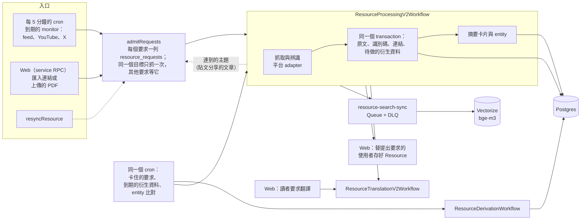

<div align="center">

# commonplot core

**[commonplot.co](https://www.commonplot.co) 背後的內容處理引擎**

[](https://workers.cloudflare.com/)
[](https://www.commonplot.co)

[English](README.md) | [繁體中文](README.zh-TW.md)

</div>

一個 Cloudflare Worker，把連結、訂閱來源和上傳的 PDF 變成可閱讀的
Resource：抓取並解析內容，認出它是什麼（論文的 DOI、影片的頻道、貼文的作者），
寫進 Postgres，再產生摘要、entity、翻譯和搜尋向量。

這個 repo 也放了給 Claude 和 ChatGPT 用的 [commonplot plugin](plugins/commonplot)。

## 來源

| 輸入 | 怎麼取得 |
| --- | --- |
| 網頁 | 抓取、跟隨轉址，把正文轉成 Markdown；回應是 PDF 就交給 PDF parser |
| PDF（連結或上傳） | Zotero document worker（Cloudflare Container）取出正文、圖和參考文獻；第一頁的識別碼透過 OpenAlex 或 Crossref 確認 |
| 論文 | DOI、arXiv 或 OpenAlex 識別碼 → OpenAlex 書目與開放取用全文；參考文獻到 Crossref 查 |
| X / Twitter | twitterapi.io：貼文或長文、媒體，以及它分享的連結 |
| YouTube | 影片資料、字幕與章節 |
| Hacker News | 主文與排序後的留言；連到的文章另成一個 Resource |
| LessWrong | 用 GraphQL 取得文章 Markdown |
| RSS / Atom / JSON Feed | 每一則都當成一個連結進來 |

## 運作方式



- **只有一個收件口。** monitor、使用者匯入、resync 和連到的主題都經過
  `admitRequests`。同一個目標的要求共用一次抓取；monitor 的要求失敗後，
  等待時間加倍再重試（`retry_after`）。
- **先寫原文。** Workflow 在同一個 transaction 寫入原文和它需要的衍生資料，
  所以寫好的 Resource 一定記著還有哪些待做。衍生資料失敗會記 `retry_at`，
  cron 再用 `ResourceDerivationWorkflow` 補做。
- **後續工作各自獨立。** 搜尋向量走 Queue，翻譯有自己的 Workflow，論文的參考文獻查
  Crossref。其中一個失敗，不會影響 Resource 本身或其他工作。
- 每次處理都會記一行 `ingest_run` log，包含結果和每一步的耗時。

## 目錄

`src/` 分層，每個目錄只 import 上面幾層。

```
src/
├── contracts/   schema 與純規則：resource 身分、kind、語言、Markdown
├── services/    外部系統：AI Gateway、Crossref、Images、Zotero、YouTube 字幕
├── adapters/    每個平台一個檔案，只負責抓取，不碰資料庫
├── store/       所有 SQL：要求、resource、衍生資料、參考文獻、monitor
├── monitors/    feed 和 X 的 monitor 與排程
├── workflows/   處理、衍生資料、翻譯、參考文獻、收件
├── search/      corpus 向量、Queue consumer、檢索、回填
└── index.ts     service RPC、cron 與 Queue 的進入點
```

### 新增一個平台

1. 在 `src/adapters/` 寫一個 adapter，把平台的資料轉成共用的 acquired-resource 格式。
2. 在 `src/contracts/resource.ts` 加上它的身分（URL 格式、`kind` 和 `platform`），
   資料庫也加對應的 constraint。
3. 如果新內容不是透過 feed 取得，再到 `src/monitors/` 加一個 monitor，並在
   `src/contracts/monitors.ts` 加上它的 kind。

Workflow、寫入和後續工作都不用改。

## 自架

需要 Cloudflare 帳號、PostgreSQL，以及 Docker（部署時會建 Zotero container）。
資料庫的 schema 和 migration 屬於 commonplot app，沒有公開。

1. **Hyperdrive** 指向你的資料庫，把 id 填進 `cloudflare.config.ts`。
   ```bash
   pnpm exec cf hyperdrive create --body '{"name":"commonplot-db","origin":{"scheme":"postgres","host":"…","port":5432,"database":"…","user":"…","password":"…"}}'
   ```
2. **Secrets**
   ```bash
   pnpm exec cf workers secrets update <NAME> --worker newsence-core --text <value>
   ```
3. **部署。** Workflow、Queue 和 container 都依 `cloudflare.config.ts` 建立。
   ```bash
   pnpm install
   pnpm exec cf deploy
   ```

本機用 `pnpm dev` 執行，再用 `curl "localhost:8787/__scheduled?cron=*/5+*+*+*+*"` 手動跑一次 cron。

| Secret | 用途 |
| --- | --- |
| `KAITO_API_KEY` | X / Twitter（twitterapi.io） |
| `YOUTUBE_API_KEY` | YouTube 資料與頻道 monitor |
| `OPENALEX_API_KEY` | 論文書目與開放取用全文 |
| `FASTINO_API_KEY` | entity 擷取 |

| Binding | 用途 |
| --- | --- |
| `HYPERDRIVE` | Postgres |
| `R2` | 上傳的 PDF、解析結果與圖片裁切 |
| `AI` | AI Gateway（摘要、翻譯）與 Workers AI embedding |
| `IMAGES` | 預覽圖與頭像 |
| `CORPUS_VECTORS` | 搜尋與相關 Resource 用的 Vectorize index（[runbook](CORPUS_VECTORS_RUNBOOK.md)） |
| `RESOURCE_SEARCH_SYNC_QUEUE` | 每次寫入後同步向量 |
| `APP` | commonplot app 的 `DomainRpc`，用來替使用者存好匯入的 Resource |

改完用 `pnpm lint` 和 `pnpm run typecheck` 檢查。

## 在 Claude 或 ChatGPT 裡使用 commonplot

commonplot 的 MCP server 在 `https://www.commonplot.co/api/mcp`（用 commonplot
帳號登入）。[plugin](plugins/commonplot) 另外附上 skill，告訴助理什麼時候該用它。
說明：[docs.commonplot.co](https://docs.commonplot.co/user/chatgpt-and-claude/)。
